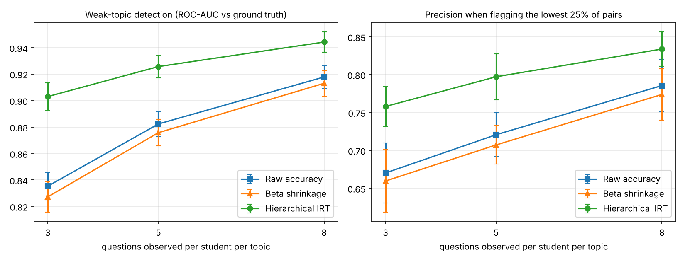

# Student Weakness Detector (Maths / Physics / Python)

[](../../actions)

Given quiz attempts, this tool estimates **how weak each student is in each topic**, ranks their weakest topics,
and suggests **unseen practice questions at the right difficulty**. It is built around a statistical question that
matters for tutors: *with only a handful of quiz answers per topic, how do you avoid misjudging a student?*

> **Data disclosure.** The benchmark below uses **synthetic quiz data** generated from a known model, so detection
> quality can be measured against ground truth. The tool itself works on any CSV of real attempts
> (`student_id, topic, question_id, correct`). **It has not been validated on real students yet**, and I make no
> claims about real-world learning gains.

## What it does

```
$ python -m weakness.cli --data data/sample_quiz_synthetic.csv --student S007

=== Weakest topics for S007 ===
          topic  score  raw_accuracy  n_attempts
Data Structures  -0.47           0.3          10
       Calculus  -0.39           0.4          10
  Python Basics  -0.35           0.4          10

=== Suggested practice questions (aimed at ~70% success) ===
          topic subject question_id  predicted_success
Data Structures  Python      DAT-14               0.73
Data Structures  Python      DAT-01               0.78
Data Structures  Python      DAT-13               0.56
       Calculus   Maths      CAL-22               0.71
...
```

## Models compared

| Estimator | Idea |
|---|---|
| Raw accuracy | % correct per student per topic (what a spreadsheet gives you) |
| Beta shrinkage | Empirical-Bayes: pull small samples toward the topic average |
| **Hierarchical IRT** | Regularised logistic model `logit P(correct) = student + student x topic - question difficulty`. Separates *hard questions* from *weak students* and borrows strength across a student's topics |

## Benchmark (synthetic data, 200 students, 8 topics, 20 independent simulations, mean over runs)

Ground truth: a student-topic pair is "weak" if its true ability is below a fixed threshold (about 1 in 4 pairs).
"Questions observed" = how many answers per topic the model sees. Held-out = prediction of answers to *new* questions.

| Questions observed | Method | Weak-topic ROC-AUC | Precision (flag lowest 25 %) | Held-out answer AUC |
|---|---|---|---|---|
| 3 | Raw accuracy | 0.835 | 0.670 | 0.689 |
| 3 | Beta shrinkage | 0.827 | 0.660 | n/a |
| 3 | **Hierarchical IRT** | **0.903** | **0.758** | **0.808** |
| 5 | Raw accuracy | 0.882 | 0.721 | 0.716 |
| 5 | Beta shrinkage | 0.876 | 0.707 | n/a |
| 5 | **Hierarchical IRT** | **0.926** | **0.797** | **0.826** |
| 8 | Raw accuracy | 0.918 | 0.786 | 0.736 |
| 8 | Beta shrinkage | 0.913 | 0.774 | n/a |
| 8 | **Hierarchical IRT** | **0.944** | **0.834** | **0.838** |



Takeaways (all from `results/results.json`):
* The hierarchical IRT model is the best at every sample size, and the gain is **largest when data are scarcest**
  (3 answers per topic: +6.8 AUC points over raw accuracy).
* **Beta shrinkage did not help** - it was marginally *worse* than raw accuracy here. I kept it in the comparison on purpose:
  shrinking toward a topic mean ignores question difficulty and the student's other topics, which is where the gain comes from.
* Only IRT can predict answers to unseen questions, which is what makes difficulty-matched recommendations possible.

## Limitations
* Synthetic data follow an IRT-like model, which **favours** the IRT estimator. Real students also forget, learn
  during the quiz, guess, and have correlated topics. Expect smaller gains on real data.
* The recommender targets ~70 % predicted success (a common "desirable difficulty" heuristic); that choice is **not
  validated** against learning outcomes.
* Ability is a static snapshot (no learning over time).

## Use it on your own data
```bash
pip install -r requirements.txt
PYTHONPATH=src python -m weakness.cli --data your_quiz.csv --student S001
```
```python
from weakness.recommend import Advisor
adv = Advisor(df)                       # df columns: student_id, topic, question_id, correct
adv.weakest_topics("S001", k=3)
adv.recommend_questions("S001", n_per_topic=3)
```
(For a non-synthetic topic list, subject labels default to blank; topics are read from your CSV.)

## Reproduce
```bash
pytest -q                    # 8 tests
python run_experiments.py    # ~1 min, regenerates results/ and data/sample_quiz_synthetic.csv
```

## Layout
```
src/weakness/simulate.py    ground-truth quiz simulator
src/weakness/estimators.py  RawAccuracy, BetaShrinkage, HierarchicalIRT
src/weakness/recommend.py   Advisor: weak topics + question recommendations
src/weakness/cli.py         command-line report
run_experiments.py          benchmark that produced the table above
```

## License
MIT
